# 20. Plan to full formalization

Generated by `make-formalization-plan.py` from the open items in
[08](08-formalization-status.md), [05](05-known-limitations.md) and the
[CryptoVerif README](../formal/cryptoverif/README.md). Edit the script, not this file.
Open [formalization-plan.html](formalization-plan.html) in a browser for the
interactive graph (zoom, search, dependency highlighting, progress tracking).

**Live progress.** Run `./plan-live.py serve` and open http://127.0.0.1:4318.
Whoever works on a step reports it with `./plan-live.py start|log|retry|block|done <id> "message"`
(`--who <name>`) from any worktree; the dashboard refreshes every 3 seconds.
Progress is stored outside the repo, in `~/.cache/vela-plan/formalization-status.json`.

133 steps, 18 dependency levels. Sizes: S < 1 day,
M 1-3 days, L about a week, XL more. **hard** marks proofs that may need a
redesign. Any step whose dependencies are all done can start, so steps on the
same level can run in parallel.

Critical path (by size): B0 -> B3 -> B4 -> O3a -> O3f -> O9 -> O13f -> H8f -> H11a -> H11b -> H11c -> H11d -> H11e -> H12 -> Z1 -> Z2 -> Z3 -> Z4

## Topological order

| # | Id | Lvl | Size | Step | Done when | After |
|---|---|---|---|---|---|---|
| 1 | B0 | 0 | S | Get PR #175 green | Cancelled formal run on 654a0ee rerun; vela-box runners healthy; every PR check passes | - |
| 2 | B1 | 1 | S | Merge PR #175 into main (when approved) | main contains the work; 08 baseline points at the merge commit. Work proceeds on the PR branch until then | B0 |
| 3 | B2 | 1 | S | Link this plan from 08 | 08 'Remaining obligations' rows each list their plan node ids | B0 |
| 4 | B3 | 1 | M | Dedupe the copied Sql/Faulty harnesses | One shared Rust test harness crate; all executor conformance suites use it and pass | B0 |
| 5 | B4 | 2 | M **hard** | One shared F* store/SQL model | All executor proofs import one Vela.Store.Model module (txn, faults, rows); per-crate copies deleted; all gates green | B3 |
| 6 | B5 | 2 | S | Plan-node check in check-correspondence | check-correspondence.py fails if a correspondence pair cites an unknown plan node | B2 |
| 7 | T1 | 1 | S | Inventory imported model contracts | Script lists every hax/std/F* library symbol the corpus relies on, with use counts; output committed | B0 |
| 8 | T2 | 2 | S | Zero-assumption gate over all F* | check-proof-boundary rejects assume/admit/axiom in extracted AND handwritten modules; mutation fixture rejected | T1 |
| 9 | T3 | 2 | M | Review the Vec model | Review note maps each used Vec op (len/index/push/extend/slice) to Rust std semantics incl. panics | T1 |
| 10 | T4 | 2 | M | Review the String/UTF-8 model | Review note for String/str/from_utf8 ops used; gaps listed as nodes or excluded | T1 |
| 11 | T5 | 2 | M | Review integer and overflow models | Every u8..u128/i64 op used is checked against Rust release-mode semantics (wrapping vs panic) | T1 |
| 12 | T6 | 2 | S | Review Option/Result/slice models | Review note committed | T1 |
| 13 | T7 | 3 | L **hard** | Differential tests of the std models | Extracted F* model functions run (OCaml extraction) against Rust on random inputs; zero mismatches over 10^6 cases per op | T3, T4, T5, T6 |
| 14 | T8 | 3 | M | Proof stability gate | Every F* module verifies with 3 Z3 seeds and z3 pinned; rlimits recorded; flaky modules split | T2 |
| 15 | T9 | 2 | S | List OS/library interface assumptions | 09 lists each assumed interface (entropy, clock, fs, locks, DB isolation) with its call sites | T1 |
| 16 | T10 | 1 | M | Pin the rest of the environment (G-3) | opam lock, action SHAs and OS packages pinned; G-3 closed | B0 |
| 17 | T11 | 2 | M | One proof container | A pinned image runs run-all.sh end to end; hosted CI uses it | T10 |
| 18 | T12 | 4 | S | Update the trusted-base docs | 07/09 updated from T7-T9; F-6 row reads closed except independent review | T7, T8, T9, T11 |
| 19 | O1 | 1 | S | Inventory observation producers | Table: every observation field -> producing code (SQL query, store get, verifier, token, clock); committed | B0 |
| 20 | O2 | 2 | M | Schema check for every rendered SQL | Gate parses migrations into a schema model and checks every byte-pinned statement's tables/columns/types | O1 |
| 21 | O3a | 3 | S | Row decoders: sharing | Row->observation decoders extracted and proved against the row model | O1, B4 |
| 22 | O3b | 4 | S | Row decoders: send links | As O3a for send | O3a |
| 23 | O3c | 4 | M | Row decoders: session and web sessions | As O3a for session | O3a |
| 24 | O3d | 4 | M | Row decoders: enrollment and pairing | As O3a for enrollment | O3a |
| 25 | O3e | 4 | M | Row decoders: recovery | As O3a for all four recovery families | O3a |
| 26 | O3f | 4 | M | Row decoders: vault, rotation, capsules | As O3a for vault | O3a |
| 27 | O4 | 2 | M | Store key builders are injective | Proof that every store key builder (rl:*, challenge, grant, ...) is injective and namespaces are disjoint | O1 |
| 28 | O5 | 3 | M **hard** | Store value codecs round-trip | decode(encode v) = v and encode injective for every stored value type | O4, T3 |
| 29 | O6 | 3 | S | Grant store-key user binding | Proof that a grant key read in a handler is bound to the session user (open item from 15) | O4 |
| 30 | O7 | 2 | M | Signature-verifier wrapper | Extracted wrapper proved: Ok iff both components verify on the exact signed bytes; components trusted | O1 |
| 31 | O8 | 2 | M | Token and session-id producer | Claims construction and parse->session observation proved; PASETO crypto trusted | O1 |
| 32 | O9 | 5 | M **hard** | Epoch freshness | Epoch read/normalize composed with the vault row model proves freshness, not just normalization | O3f |
| 33 | O10 | 3 | M | TTL expiry as adversarial deletion | Store model lets expiry delete any TTL key at any step; driver and executor theorems still hold | B4 |
| 34 | O11 | 3 | S | Nonce source contract | Nonce length and single use proved; entropy trusted per T9 | T9 |
| 35 | O12 | 5 | S | Prove the EnrollmentAccountView adapter | Adapter extracted and proved; conformance test kept as backup | O3d |
| 36 | O13a | 4 | M | Context origins: sharing | Every context field used in sharing admission is proved to come from the session or a DB row, never the body | O3a, O8 |
| 37 | O13b | 5 | S | Context origins: send links | As O13a | O3b, O8 |
| 38 | O13c | 5 | M | Context origins: session | As O13a | O3c, O8 |
| 39 | O13d | 6 | M | Context origins: enrollment | As O13a | O3d, O8, O12 |
| 40 | O13e | 5 | M | Context origins: recovery | As O13a; includes WebAuthn verdict origin | O3e, O8, O7, O6 |
| 41 | O13f | 6 | M | Context origins: vault | As O13a | O3f, O8, O9 |
| 42 | O14a | 3 | M | Share-envelope encoder inverse | parse(encode x) = x over the checked byte-frame grammar | T4 |
| 43 | O14b | 4 | M | UTF-8/object conversion | Opened bytes -> object conversion proved against the String model | T4, O14a |
| 44 | O14c | 5 | L **hard** | Authenticated-open composition | frame parse ; signature check ; open ; object decode composed into one theorem for the production opener | O14b, O7 |
| 45 | O15 | 5 | M | Recovery fact construction leftovers | Decoders, verifiers, storage effects and restoration for recovery covered (open items from 13/15) | O3e, O7 |
| 46 | H1 | 1 | S | Handler inventory | Every route (about 60 route entries) tagged: parse / origins / interpreter / reply, each covered or not | B0 |
| 47 | H2 | 1 | M | Fix U-24 (lost recovery-redemption reply) | Device row records its grant, replay recovers the device id; proved in the redemption driver; U-24 closed | B0 |
| 48 | H3 | 2 | S | Cancellation lemma for the U-24 fix | Cancellation README shows no lost-reply case left | H2 |
| 49 | H4 | 3 | M | Request validation | For each handler, typed request -> validated input proved (JSON decode itself trusted per T9) | H1, T4 |
| 50 | H5 | 2 | M | Reply construction | Verdict -> status/body mapping proved total and leak-free for every handler | H1 |
| 51 | H6 | 3 | M | Auth middleware | Middleware session extraction proved; composed with O8 | O8, H1 |
| 52 | H7 | 3 | M | Read-only and leftover routes | Routes with no driver (GET /devices, /sends, /vault/events, /health, ...) proved write-free and auth-correct | H1, B4 |
| 53 | H8a | 5 | L | Whole-handler theorem: sharing | parse ; middleware ; origins ; interpreter ; reply refines the M19b/M21 state machine | H4, H5, H6, O13a |
| 54 | H8b | 6 | M | Whole-handler theorem: send links | As H8a | H4, H5, H6, O13b |
| 55 | H8c | 6 | L | Whole-handler theorem: session and web sessions | As H8a | H4, H5, H6, O13c |
| 56 | H8d | 7 | L | Whole-handler theorem: enrollment and pairing | As H8a (M13) | H4, H5, H6, O13d |
| 57 | H8e | 6 | L **hard** | Whole-handler theorem: recovery | As H8a (M18/M26a) | H4, H5, H6, O13e, O15, H3 |
| 58 | H8f | 7 | L **hard** | Whole-handler theorem: vault and rekey | As H8a (M11) | H4, H5, H6, O13f, O10 |
| 59 | H8g | 6 | M | Whole-handler theorem: account deletion | As H8a | H4, H5, H6, O13c |
| 60 | H9 | 8 | M | Early returns and panic freedom | Every early-return path proved to match the spec's state; deny(unwrap/expect/indexing) in handlers | H8a, H8b, H8c, H8d, H8e, H8f, H8g |
| 61 | H10 | 3 | M | DB isolation stated and tested | Turso/sled linearizability kept as a named trusted interface, backed by a concurrency conformance suite | T9 |
| 62 | H11a | 8 | M | Cross-driver world: add vault and rekey | Composition theorem re-proved with the new drivers | H8f, H10 |
| 63 | H11b | 9 | M | Cross-driver world: add sharing and send | As H11a | H11a, H8a, H8b |
| 64 | H11c | 10 | M | Cross-driver world: add web sessions and enrollment | As H11a | H11b, H8c, H8d |
| 65 | H11d | 11 | L **hard** | Drop the 'four reads are one step' assumption | Admission reads interleave freely; theorem still holds or a fix lands | H11c |
| 66 | H11e | 12 | L **hard** | Revocation landing mid-request | Remove the 'checked at start/decision' assumption for revocation and pairing | H11d |
| 67 | H12 | 13 | S | Close F-1 and F-2 in 08 | Both rows say closed under the boundary; evidence READMEs and correspondence pairs updated | H9, H11e, O2, O14c |
| 68 | P1 | 1 | S | Journal implementation inventory | Map vela-desktop-core store/sharing/sync journal ops to M28 rules | B0 |
| 69 | P2a | 1 | M | Tamarin bridge: source term representation | F* type for Tamarin terms used by M28 | B0 |
| 70 | P2b | 2 | M | Tamarin bridge: slot projection | Proved projection from multi-slot traces to single-slot | P2a |
| 71 | P2c | 2 | M **hard** | Tamarin bridge: derivability and freshness | Input derivability and global freshness encoded | P2a |
| 72 | P2d | 3 | L **hard** | Tamarin bridge theorem | Source traces embed into the core encoding and lifts are admissible; M28 lemmas transfer | P2b, P2c |
| 73 | P3a | 2 | M | Extract the journal step function | Pure journal step in Rust, called by the real code, extracted by hax | P1 |
| 74 | P3b | 4 | L **hard** | Journal step refines M28 | Every Rust step maps to an M28 rule or a stutter | P3a, P2d |
| 75 | P3c | 3 | M **hard** | Filesystem model | F* model of write/rename/fsync/crash under the T9 interface | T9 |
| 76 | P3d | 4 | L **hard** | File operations implement durability phases | Proof that the fs calls realize Persist/Clear phases under any crash point | P3a, P3c |
| 77 | P4 | 3 | M | Collection equality | Formal definition and proof used by sync/journal | P3a |
| 78 | P5 | 5 | M | Compose local edits and deletions | Edits/deletions composed with the journal refinement | P3b, P4 |
| 79 | P6 | 5 | M | Compose RMS migration | Migration path proved to preserve journal invariants | P3b |
| 80 | P7 | 4 | M | Independent processes | Either a lock with a proved mutual-exclusion argument, or an explicit exclusion in 09 | P3c |
| 81 | P8 | 5 | M | Uncertain-write re-arm ordering | The fixed re-arm ordering proved, regression kept | P3d |
| 82 | P9 | 6 | S | Close F-3 in 08 | Gate in CI; F-3 row closed | P5, P6, P7, P8 |
| 83 | C1 | 1 | M | SHA-256 bridge as a game | Collision step for ct_mlkem/pk_mlkem machine-checked in CryptoVerif | B0 |
| 84 | C2 | 1 | L **hard** | X25519 cofactor and low-order inputs | Game models cofactor-8 group and the kem.rs reject check | B0 |
| 85 | C3a | 3 | M | kem.rs encoding checks in Rust | hax proof that kem.rs rejects low-order/non-canonical inputs as claimed | T5 |
| 86 | C3b | 4 | M | Link wire encodings to the game | Encoding->group-element map proved injective modulo the rejected set | C3a, C2 |
| 87 | C4 | 1 | M **hard** | Clamped scalar distribution | Machine-checked collision bound for the clamped distribution | B0 |
| 88 | C5 | 5 | L **hard** | Concrete X25519 combiner theorem | One theorem replacing the model-level COMP-5 | C1, C3b, C4 |
| 89 | C6 | 2 | L **hard** | Multi-user, multi-challenge KEM | Game or hybrid argument with stated loss | C1 |
| 90 | C7a | 1 | S | Decide quantum-query scope | Choice recorded in 09: QROM proof, paper reduction, or excluded | B0 |
| 91 | C7b | 6 | XL **hard** | Quantum-query composition | In scope (09, 2026-11-04): QROM or random-oracle-free reductions for the hybrid KEM and signature claims, with stated losses | C7a, C5 |
| 92 | C8 | 6 | M | Instantiate KEM-DEM with the combiner | Composition lemma checked, not manual | C5, C6 |
| 93 | C9 | 7 | M **hard** | AAD and signed share-envelope game | Encryption theorem covers the real envelope with AAD | C8, O14a |
| 94 | C10 | 1 | L **hard** | HKDF beyond the random oracle | Reductions under named PRF/extractor assumptions | B0 |
| 95 | C11 | 8 | M | Envelope framing game | Framing injectivity (from wire proofs) used in the game | C9 |
| 96 | C12 | 3 | M | Hybrid-signature Rust wrapper correspondence | Wrapper <-> game composition closed (open item in 10) | O7 |
| 97 | C13 | 2 | M | Recovery KDF and password-hashing constructions | Game for recovery key derivation | C10 |
| 98 | C14 | 3 | M | Application randomness | Keys/nonces drawn from the OS RNG with right lengths; AEAD nonce uniqueness proved | T9 |
| 99 | C15 | 1 | M | Uniform decryption errors | No error-oracle: all decrypt failures map to one error, proved at the wrapper | B0 |
| 100 | C16 | 1 | M | Secret erasure | Zeroize gate: secret types implement ZeroizeOnDrop; lint plus review | B0 |
| 101 | C17 | 1 | S | Remove the legacy v1 envelope path | decapsulate_legacy_v1 and its recovery.rs caller removed (decided 2026-11-04); tests and docs updated | B0 |
| 102 | C18 | 9 | S | Close F-4 in 08 | CryptoVerif README open list empty or excluded | C7b, C11, C12, C13, C14, C15, C16, C17 |
| 103 | N1 | 1 | S | FFI call-site inventory | Every Kotlin/Swift/TS call into the bridges listed | B0 |
| 104 | N0a | 2 | M | Desktop: refuse unbound legacy chunks (U-28) | Desktop downloads refuse unsealed blobs as the mobile bridges do (or a recorded migration re-seals them first); regression test; U-28 closed | N1 |
| 105 | N0b | 3 | S | Desktop: rollback gate on established facts (U-29) | plan_chunk_download gets facts the open actually established, not literals; U-29 closed | N0a |
| 106 | N0c | 2 | M | Web: admitted downloads (U-27) | The WASM bridge exports the admitted download path; web refuses unsealed blobs and epochs below a floor it can authenticate; U-27 closed | N1 |
| 107 | N2a | 2 | M | Android bridge is a thin wrapper | hax proof: bridge fns call verified policies, no extra logic | N1 |
| 108 | N2b | 2 | M | Apple bridge is a thin wrapper | As N2a | N1 |
| 109 | N2c | 2 | M | WASM bridge is a thin wrapper | As N2a | N1 |
| 110 | N3 | 3 | M | FFI type mapping | Bytes, errors and nullability mapping reviewed and tested both ways | N2a, N2b, N2c |
| 111 | N4 | 2 | S | Choose the caller-verification method | Decided 2026-11-04 (09): thin callers + CI rules + conformance/property tests | N1 |
| 112 | N5a | 4 | M | Android sync caller | CI rule rejects any sync download that bypasses the bridge or ignores its error; property tests match the Rust rules | N4, N3 |
| 113 | N5b | 5 | M | Android sharing caller | As N5a (CI rule + property tests) | N5a |
| 114 | N5c | 5 | M | Android enrollment/recovery caller | As N5a (CI rule + property tests) | N5a |
| 115 | N5d | 5 | L **hard** | Android persistence | EncryptedVaultStore writes refine the journal contract | N5a, P3d |
| 116 | N6a | 4 | M | iOS sync caller | As N5a | N4, N3 |
| 117 | N6b | 5 | M | iOS sharing caller | As N5a | N6a |
| 118 | N6c | 5 | M | iOS enrollment/recovery caller | As N5a | N6a |
| 119 | N6d | 5 | L **hard** | iOS persistence | As N5d | N6a, P3d |
| 120 | N7a | 4 | M | Desktop callers (gpui and Tauri) | As N5a | N4, N3, N0b |
| 121 | N7b | 4 | M | Web and extension callers | As N5a | N4, N3, N0c |
| 122 | N8 | 5 | M **hard** | Native conformance at scale | Property-based conformance of every native caller flow against the Rust rules runs in CI on Android and iOS (no unbounded proof, per N4) | N5a, N6a |
| 123 | N9 | 1 | M **hard** | Enrollment UI trust | Tamarin model of the human code comparison (extends M13) | B0 |
| 124 | N10a | 1 | M | Joint model skeleton | One Tamarin theory with shared accounts/devices/keys | B0 |
| 125 | N10b | 2 | M | Joint model: enrollment and recovery | Rules imported, lemmas re-proved | N10a, N9 |
| 126 | N10c | 3 | M | Joint model: sync | As N10b | N10b |
| 127 | N10d | 4 | M | Joint model: sharing | As N10b | N10c |
| 128 | N10e | 5 | L **hard** | Joint model: revocation and claims | TC-6 claims proved in the joint model | N10d |
| 129 | N11 | 6 | S | Close F-5 in 08 | F-5 row closed; U-8 closed | N5b, N5c, N5d, N6b, N6c, N6d, N7a, N7b, N8, N10e |
| 130 | Z1 | 14 | M | Automate model<->policy correspondence (G-5) | Drift gate covers every family and mobile call site | H12, N11 |
| 131 | Z2 | 15 | S | Whole-system claim in 08 | 08 header replaced by a scoped completion claim with its boundary | Z1, T12, P9, C18, B1 |
| 132 | Z3 | 16 | S | Hosted full run | run-all.sh green in the proof container on the claim commit | Z2 |
| 133 | Z4 | 17 | L | Independent review (G-6) | Third party reproduces Z3 and reviews models; G-6 closed | Z3 |

## Dependency DAG

```mermaid
flowchart TB
  subgraph B["Baseline and bookkeeping"]
    B0["B0 Get PR #175 green"]
    B1["B1 Merge PR #175 into main (when approved)"]
    B2["B2 Link this plan from 08"]
    B3["B3 Dedupe the copied Sql/Faulty harnesses"]
    B4{{"B4 One shared F* store/SQL model"}}
    B5["B5 Plan-node check in check-correspondence"]
  end
  subgraph T["F-6 trusted base"]
    T1["T1 Inventory imported model contracts"]
    T2["T2 Zero-assumption gate over all F*"]
    T3["T3 Review the Vec model"]
    T4["T4 Review the String/UTF-8 model"]
    T5["T5 Review integer and overflow models"]
    T6["T6 Review Option/Result/slice models"]
    T7{{"T7 Differential tests of the std models"}}
    T8["T8 Proof stability gate"]
    T9["T9 List OS/library interface assumptions"]
    T10["T10 Pin the rest of the environment (G-3)"]
    T11["T11 One proof container"]
    T12["T12 Update the trusted-base docs"]
  end
  subgraph O["F-1 observation origins"]
    O1["O1 Inventory observation producers"]
    O2["O2 Schema check for every rendered SQL"]
    O3a["O3a Row decoders: sharing"]
    O3b["O3b Row decoders: send links"]
    O3c["O3c Row decoders: session and web sessions"]
    O3d["O3d Row decoders: enrollment and pairing"]
    O3e["O3e Row decoders: recovery"]
    O3f["O3f Row decoders: vault, rotation, capsules"]
    O4["O4 Store key builders are injective"]
    O5{{"O5 Store value codecs round-trip"}}
    O6["O6 Grant store-key user binding"]
    O7["O7 Signature-verifier wrapper"]
    O8["O8 Token and session-id producer"]
    O9{{"O9 Epoch freshness"}}
    O10["O10 TTL expiry as adversarial deletion"]
    O11["O11 Nonce source contract"]
    O12["O12 Prove the EnrollmentAccountView adapter"]
    O13a["O13a Context origins: sharing"]
    O13b["O13b Context origins: send links"]
    O13c["O13c Context origins: session"]
    O13d["O13d Context origins: enrollment"]
    O13e["O13e Context origins: recovery"]
    O13f["O13f Context origins: vault"]
    O14a["O14a Share-envelope encoder inverse"]
    O14b["O14b UTF-8/object conversion"]
    O14c{{"O14c Authenticated-open composition"}}
    O15["O15 Recovery fact construction leftovers"]
  end
  subgraph H["F-1/F-2 full handlers and server composition"]
    H1["H1 Handler inventory"]
    H2["H2 Fix U-24 (lost recovery-redemption reply)"]
    H3["H3 Cancellation lemma for the U-24 fix"]
    H4["H4 Request validation"]
    H5["H5 Reply construction"]
    H6["H6 Auth middleware"]
    H7["H7 Read-only and leftover routes"]
    H8a["H8a Whole-handler theorem: sharing"]
    H8b["H8b Whole-handler theorem: send links"]
    H8c["H8c Whole-handler theorem: session and web sessions"]
    H8d["H8d Whole-handler theorem: enrollment and pairing"]
    H8e{{"H8e Whole-handler theorem: recovery"}}
    H8f{{"H8f Whole-handler theorem: vault and rekey"}}
    H8g["H8g Whole-handler theorem: account deletion"]
    H9["H9 Early returns and panic freedom"]
    H10["H10 DB isolation stated and tested"]
    H11a["H11a Cross-driver world: add vault and rekey"]
    H11b["H11b Cross-driver world: add sharing and send"]
    H11c["H11c Cross-driver world: add web sessions and enrollment"]
    H11d{{"H11d Drop the 'four reads are one step' assumption"}}
    H11e{{"H11e Revocation landing mid-request"}}
    H12["H12 Close F-1 and F-2 in 08"]
  end
  subgraph P["F-3 client persistence and recovery"]
    P1["P1 Journal implementation inventory"]
    P2a["P2a Tamarin bridge: source term representation"]
    P2b["P2b Tamarin bridge: slot projection"]
    P2c{{"P2c Tamarin bridge: derivability and freshness"}}
    P2d{{"P2d Tamarin bridge theorem"}}
    P3a["P3a Extract the journal step function"]
    P3b{{"P3b Journal step refines M28"}}
    P3c{{"P3c Filesystem model"}}
    P3d{{"P3d File operations implement durability phases"}}
    P4["P4 Collection equality"]
    P5["P5 Compose local edits and deletions"]
    P6["P6 Compose RMS migration"]
    P7["P7 Independent processes"]
    P8["P8 Uncertain-write re-arm ordering"]
    P9["P9 Close F-3 in 08"]
  end
  subgraph C["F-4 construction security"]
    C1["C1 SHA-256 bridge as a game"]
    C2{{"C2 X25519 cofactor and low-order inputs"}}
    C3a["C3a kem.rs encoding checks in Rust"]
    C3b["C3b Link wire encodings to the game"]
    C4{{"C4 Clamped scalar distribution"}}
    C5{{"C5 Concrete X25519 combiner theorem"}}
    C6{{"C6 Multi-user, multi-challenge KEM"}}
    C7a["C7a Decide quantum-query scope"]
    C7b{{"C7b Quantum-query composition"}}
    C8["C8 Instantiate KEM-DEM with the combiner"]
    C9{{"C9 AAD and signed share-envelope game"}}
    C10{{"C10 HKDF beyond the random oracle"}}
    C11["C11 Envelope framing game"]
    C12["C12 Hybrid-signature Rust wrapper correspondence"]
    C13["C13 Recovery KDF and password-hashing constructions"]
    C14["C14 Application randomness"]
    C15["C15 Uniform decryption errors"]
    C16["C16 Secret erasure"]
    C17["C17 Remove the legacy v1 envelope path"]
    C18["C18 Close F-4 in 08"]
  end
  subgraph N["F-5 native clients and protocol composition"]
    N1["N1 FFI call-site inventory"]
    N0a["N0a Desktop: refuse unbound legacy chunks (U-28)"]
    N0b["N0b Desktop: rollback gate on established facts (U-29)"]
    N0c["N0c Web: admitted downloads (U-27)"]
    N2a["N2a Android bridge is a thin wrapper"]
    N2b["N2b Apple bridge is a thin wrapper"]
    N2c["N2c WASM bridge is a thin wrapper"]
    N3["N3 FFI type mapping"]
    N4["N4 Choose the caller-verification method"]
    N5a["N5a Android sync caller"]
    N5b["N5b Android sharing caller"]
    N5c["N5c Android enrollment/recovery caller"]
    N5d{{"N5d Android persistence"}}
    N6a["N6a iOS sync caller"]
    N6b["N6b iOS sharing caller"]
    N6c["N6c iOS enrollment/recovery caller"]
    N6d{{"N6d iOS persistence"}}
    N7a["N7a Desktop callers (gpui and Tauri)"]
    N7b["N7b Web and extension callers"]
    N8{{"N8 Native conformance at scale"}}
    N9{{"N9 Enrollment UI trust"}}
    N10a["N10a Joint model skeleton"]
    N10b["N10b Joint model: enrollment and recovery"]
    N10c["N10c Joint model: sync"]
    N10d["N10d Joint model: sharing"]
    N10e{{"N10e Joint model: revocation and claims"}}
    N11["N11 Close F-5 in 08"]
  end
  subgraph Z["Closing"]
    Z1["Z1 Automate model<->policy correspondence (G-5)"]
    Z2["Z2 Whole-system claim in 08"]
    Z3["Z3 Hosted full run"]
    Z4["Z4 Independent review (G-6)"]
  end
  B0 --> B1
  B0 --> B2
  B0 --> B3
  B3 --> B4
  B2 --> B5
  B0 --> T1
  T1 --> T2
  T1 --> T3
  T1 --> T4
  T1 --> T5
  T1 --> T6
  T3 --> T7
  T4 --> T7
  T5 --> T7
  T6 --> T7
  T2 --> T8
  T1 --> T9
  B0 --> T10
  T10 --> T11
  T7 --> T12
  T8 --> T12
  T9 --> T12
  T11 --> T12
  B0 --> O1
  O1 --> O2
  O1 --> O3a
  B4 --> O3a
  O3a --> O3b
  O3a --> O3c
  O3a --> O3d
  O3a --> O3e
  O3a --> O3f
  O1 --> O4
  O4 --> O5
  T3 --> O5
  O4 --> O6
  O1 --> O7
  O1 --> O8
  O3f --> O9
  B4 --> O10
  T9 --> O11
  O3d --> O12
  O3a --> O13a
  O8 --> O13a
  O3b --> O13b
  O8 --> O13b
  O3c --> O13c
  O8 --> O13c
  O3d --> O13d
  O8 --> O13d
  O12 --> O13d
  O3e --> O13e
  O8 --> O13e
  O7 --> O13e
  O6 --> O13e
  O3f --> O13f
  O8 --> O13f
  O9 --> O13f
  T4 --> O14a
  T4 --> O14b
  O14a --> O14b
  O14b --> O14c
  O7 --> O14c
  O3e --> O15
  O7 --> O15
  B0 --> H1
  B0 --> H2
  H2 --> H3
  H1 --> H4
  T4 --> H4
  H1 --> H5
  O8 --> H6
  H1 --> H6
  H1 --> H7
  B4 --> H7
  H4 --> H8a
  H5 --> H8a
  H6 --> H8a
  O13a --> H8a
  H4 --> H8b
  H5 --> H8b
  H6 --> H8b
  O13b --> H8b
  H4 --> H8c
  H5 --> H8c
  H6 --> H8c
  O13c --> H8c
  H4 --> H8d
  H5 --> H8d
  H6 --> H8d
  O13d --> H8d
  H4 --> H8e
  H5 --> H8e
  H6 --> H8e
  O13e --> H8e
  O15 --> H8e
  H3 --> H8e
  H4 --> H8f
  H5 --> H8f
  H6 --> H8f
  O13f --> H8f
  O10 --> H8f
  H4 --> H8g
  H5 --> H8g
  H6 --> H8g
  O13c --> H8g
  H8a --> H9
  H8b --> H9
  H8c --> H9
  H8d --> H9
  H8e --> H9
  H8f --> H9
  H8g --> H9
  T9 --> H10
  H8f --> H11a
  H10 --> H11a
  H11a --> H11b
  H8a --> H11b
  H8b --> H11b
  H11b --> H11c
  H8c --> H11c
  H8d --> H11c
  H11c --> H11d
  H11d --> H11e
  H9 --> H12
  H11e --> H12
  O2 --> H12
  O14c --> H12
  B0 --> P1
  B0 --> P2a
  P2a --> P2b
  P2a --> P2c
  P2b --> P2d
  P2c --> P2d
  P1 --> P3a
  P3a --> P3b
  P2d --> P3b
  T9 --> P3c
  P3a --> P3d
  P3c --> P3d
  P3a --> P4
  P3b --> P5
  P4 --> P5
  P3b --> P6
  P3c --> P7
  P3d --> P8
  P5 --> P9
  P6 --> P9
  P7 --> P9
  P8 --> P9
  B0 --> C1
  B0 --> C2
  T5 --> C3a
  C3a --> C3b
  C2 --> C3b
  B0 --> C4
  C1 --> C5
  C3b --> C5
  C4 --> C5
  C1 --> C6
  B0 --> C7a
  C7a --> C7b
  C5 --> C7b
  C5 --> C8
  C6 --> C8
  C8 --> C9
  O14a --> C9
  B0 --> C10
  C9 --> C11
  O7 --> C12
  C10 --> C13
  T9 --> C14
  B0 --> C15
  B0 --> C16
  B0 --> C17
  C7b --> C18
  C11 --> C18
  C12 --> C18
  C13 --> C18
  C14 --> C18
  C15 --> C18
  C16 --> C18
  C17 --> C18
  B0 --> N1
  N1 --> N0a
  N0a --> N0b
  N1 --> N0c
  N1 --> N2a
  N1 --> N2b
  N1 --> N2c
  N2a --> N3
  N2b --> N3
  N2c --> N3
  N1 --> N4
  N4 --> N5a
  N3 --> N5a
  N5a --> N5b
  N5a --> N5c
  N5a --> N5d
  P3d --> N5d
  N4 --> N6a
  N3 --> N6a
  N6a --> N6b
  N6a --> N6c
  N6a --> N6d
  P3d --> N6d
  N4 --> N7a
  N3 --> N7a
  N0b --> N7a
  N4 --> N7b
  N3 --> N7b
  N0c --> N7b
  N5a --> N8
  N6a --> N8
  B0 --> N9
  B0 --> N10a
  N10a --> N10b
  N9 --> N10b
  N10b --> N10c
  N10c --> N10d
  N10d --> N10e
  N5b --> N11
  N5c --> N11
  N5d --> N11
  N6b --> N11
  N6c --> N11
  N6d --> N11
  N7a --> N11
  N7b --> N11
  N8 --> N11
  N10e --> N11
  H12 --> Z1
  N11 --> Z1
  Z1 --> Z2
  T12 --> Z2
  P9 --> Z2
  C18 --> Z2
  B1 --> Z2
  Z2 --> Z3
  Z3 --> Z4
```

## Levels

- **0**: B0
- **1**: B1, B2, B3, T1, T10, O1, H1, H2, P1, P2a, C1, C2, C4, C7a, C10, C15, C16, C17, N1, N9, N10a
- **2**: B4, B5, T2, T3, T4, T5, T6, T9, T11, O2, O4, O7, O8, H3, H5, P2b, P2c, P3a, C6, C13, N0a, N0c, N2a, N2b, N2c, N4, N10b
- **3**: T7, T8, O3a, O5, O6, O10, O11, O14a, H4, H6, H7, H10, P2d, P3c, P4, C3a, C12, C14, N0b, N3, N10c
- **4**: T12, O3b, O3c, O3d, O3e, O3f, O13a, O14b, P3b, P3d, P7, C3b, N5a, N6a, N7a, N7b, N10d
- **5**: O9, O12, O13b, O13c, O13e, O14c, O15, H8a, P5, P6, P8, C5, N5b, N5c, N5d, N6b, N6c, N6d, N8, N10e
- **6**: O13d, O13f, H8b, H8c, H8e, H8g, P9, C7b, C8, N11
- **7**: H8d, H8f, C9
- **8**: H9, H11a, C11
- **9**: H11b, C18
- **10**: H11c
- **11**: H11d
- **12**: H11e
- **13**: H12
- **14**: Z1
- **15**: Z2
- **16**: Z3
- **17**: Z4
